<p align="center">
  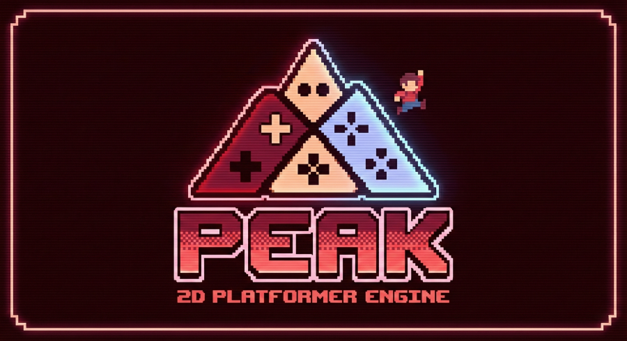
</p>

<h3 align="center">Tiny evolved neural networks playtest 2D games.<br>Does a playtest notice a one-tile change?</h3>

<p align="center">
  
  
  
  
  
</p>

<p align="center">
  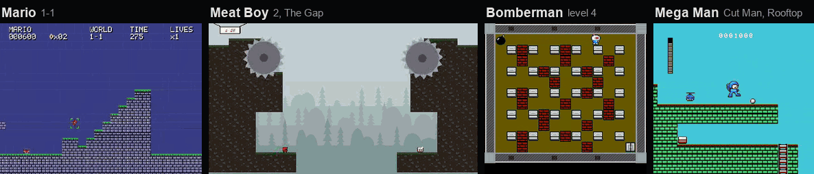
</p>

**PEAK** (Ontario Tech University, Master's program) evolves small neural networks that play four
2D games like six kinds of player. It measures how hard every level is, then changes one tile of a
level and checks whether a playtest notices. People play the same levels, so humans and agents can be
compared.

---

## How it works

<p align="center">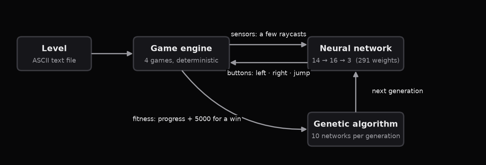</p>

<table>
<tr>
<td width="50%" align="center">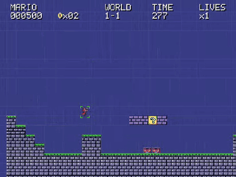<br><sub><b>A trained agent wins.</b> The experienced persona's network (200 generations, Nibi run) reaches the flag of Mario 1-1.</sub></td>
<td width="50%" align="center">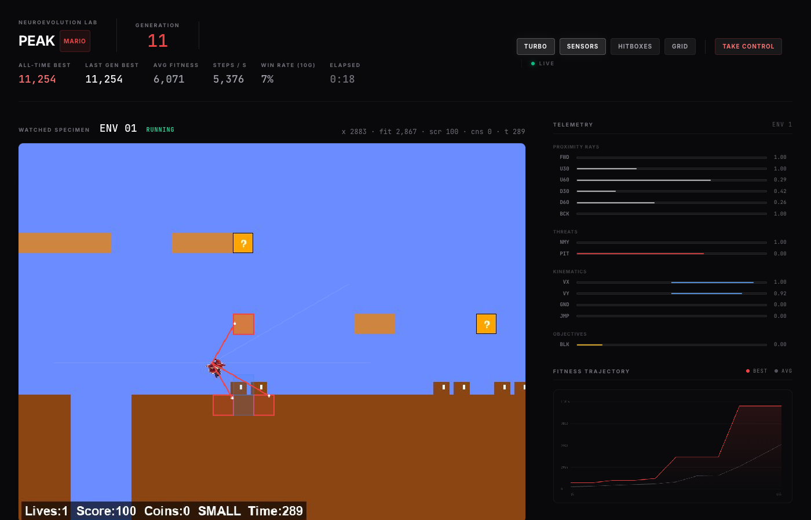<br><sub><b>Live dashboard.</b> One agent with its raycasts, its inputs and its fitness.</sub></td>
</tr>
</table>

| | |
|---|---|
| 🎮 **4 games** | Mario 1-1 to 1-4 · Meat Boy world 1 (11 levels) · Bomberman (16 levels) · Mega Man Cut Man (8 sections) |
| 🧠 **The agent** | One hidden layer of 16 units, 291 to 534 weights. No gradients, no GPU. |
| 🧬 **Evolution** | 10 networks, elitism, tournament, crossover, mutation. One seed fixes every random choice. |
| 🧍 **6 personas** | novice · clumsy · experienced · speedrunner · killer · collector |
| 🧪 **Mutation testing** | 5 one-change copies of every level: is the change noticed? |

---

## Quick start

```bash
git clone https://github.com/Code-SorceryLab/PEAK-DRL-Tool.git
cd PEAK-DRL-Tool
pip install -r requirements.txt
python menu.py        # train, watch, play, sweep, mutate, run the user study, open the Command Center
```

### SPEEDY: a fifth game, not in the results yet

SPEEDY rebuilds the first zone of the 1991 Mega Drive hedgehog platformer on this engine: Green Hill,
Acts 1 to 3 with the boss. The player routine keeps the console's order of operations and its 1/256 px
units, including loops, S-tunnels, ring scatter and the 1991 spike behaviour. The Spin Dash (hold down,
press jump to charge, let go to fire) comes from the later games. The Special Stage is not included.

The levels are geometry and object positions traced from public maps (`code/games/levels/speedy/`).
Every sprite and the music are our own, made in code, in the look and style of the original. To use art
or audio you own, put it in `speedy-data/` (ignored by git): `speedy-data/art/<sprite>.png` replaces a
sprite and `speedy-data/speedy.ogg` replaces the tune.

```bash
python -m code.games.tools.manual_play --game speedy
python -m code.neuro.trainer --game speedy --level green_hill_1
python -m code.neuro.balance --game speedy
```

---

## The experiment at a glance

One pipeline run on the **Nibi** cluster (Digital Research Alliance of Canada), started 2026-10-28,
ended 2026-10-29 at 11:06 pm. Every stage ended with exit code 0.
Seeds **1234, 2025, 31337**.

<p align="center">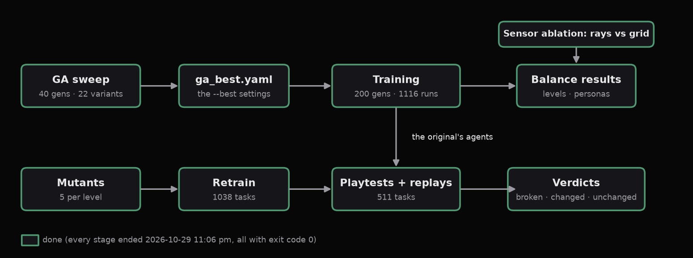</p>

| Experiment | Size | State |
|---|---|---|
| Main training: every level, persona, GA setting, seed (200 generations) | 1116 runs | ✅ done |
| GA sweep: 22 variants per game and persona (40 generations) | 24 sweeps | ✅ done |
| Sensor ablation: rays vs grid (40 generations) | 3 games × 6 personas | ✅ done |
| Retraining on every mutant (200 generations) | 1038 tasks | ✅ done |
| Playtests, replays, verdicts | 511 tasks + metrics | ✅ done |
| Pilot user study | 5 participants | ✅ pilot done |

---

## Results

### How hard is each level?

<p align="center">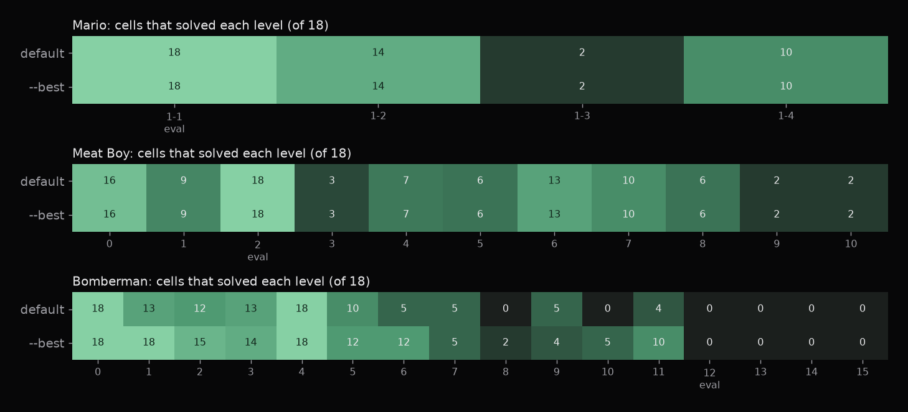</p>

Each square counts the runs (6 personas × 3 seeds) that solved the level. **Mario 1-3** and
**Meat Boy 9 and 10** are the walls. The four **Bomberman II levels (12 to 15)**, the evaluation level
included, were never solved. `--best` helps Bomberman most (133 vs 103 runs solved).

<details>
<summary>🔍 Per persona, per level, win rates and confidence intervals</summary>
<p align="center">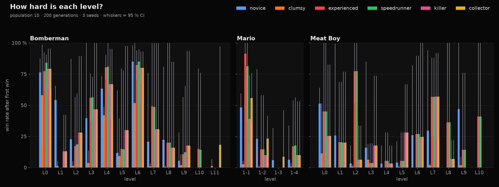</p>
<p align="center">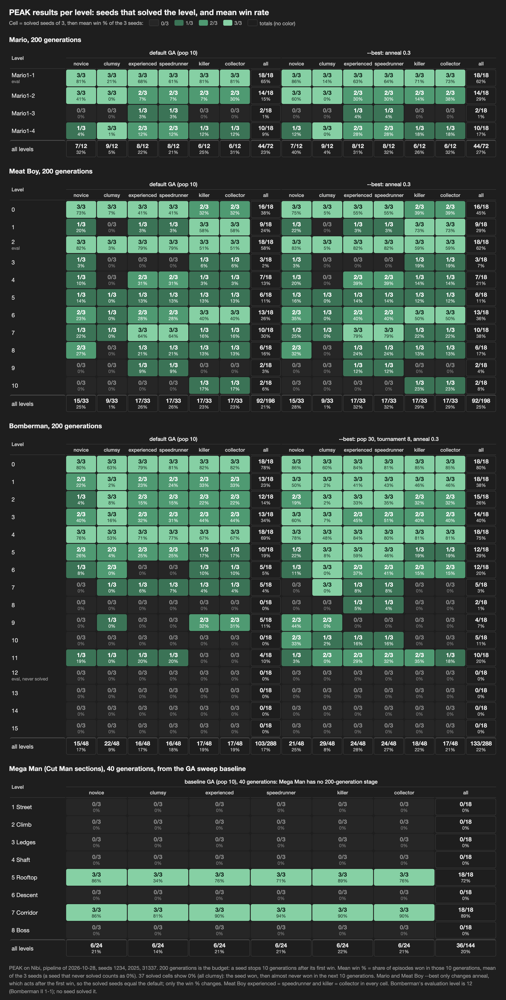</p>
</details>

### Who wins?

<p align="center">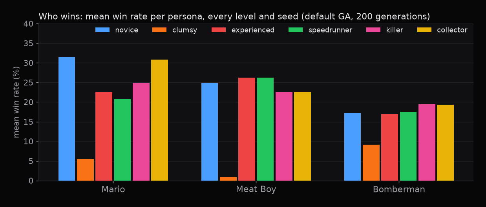</p>

**Clumsy** is the weakest player in every game. In Meat Boy, experienced = speedrunner and
killer = collector (the game has no enemies or coins).

<details>
<summary>🔍 Per persona: mean win rate and levels solved, default GA and --best</summary>
<p align="center">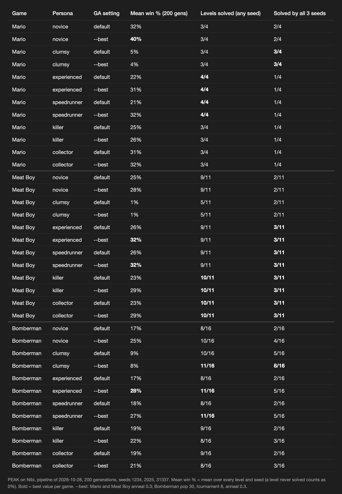</p>
</details>

### Which GA settings help?

<p align="center">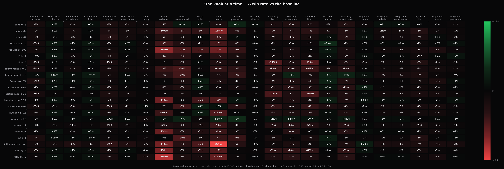</p>

One setting moved at a time, paired on the same seeds (★ = outside the 95% CI). A lower **anneal
factor (0.3)** helps in every game, so it is in every game's `--best`:

| Game | `--best` (only these change) |
|---|---|
| Mario · Meat Boy | anneal 0.3 |
| Bomberman | population 30 · tournament 8 · anneal 0.3 |
| Mega Man | population 30 · elite 1 · mutation rate 0.5 · anneal 0.3 |

### Does the agent need to see more?

<p align="center">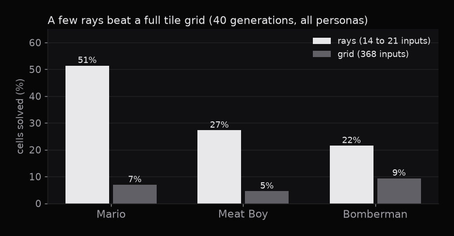</p>

No. A few raycasts beat a full 368-cell tile grid in every game: more inputs, more weights to evolve.

<details>
<summary>🔍 Per persona, paired, with confidence intervals</summary>
<p align="center">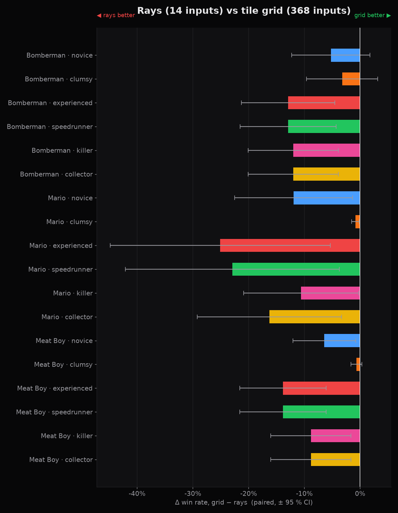</p>
</details>

### Mutation testing: does a playtest notice one change?

<p align="center">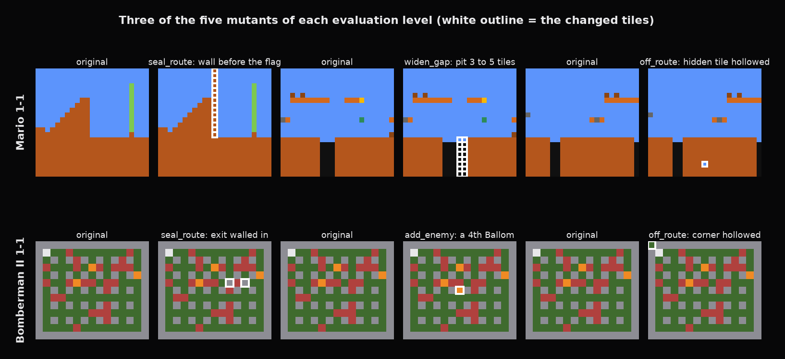</p>

| Operator | Change | Class |
|---|---|---|
| `seal_route` | a wall cuts the route | 🔴 breaking |
| `widen_gap` / `add_enemy` | a gap 2 tiles wider / one more enemy | 🟠 degrading |
| `jump_velocity_down` / `fuse_down` | jump ×0.85 / bomb fuse ×0.625 | 🟠 degrading |
| `off_route` | a tile nobody can reach | 🟢 neutral |
| `cosmetic_tile` | `.` written as a space | ⚪ equivalent |

<p align="center">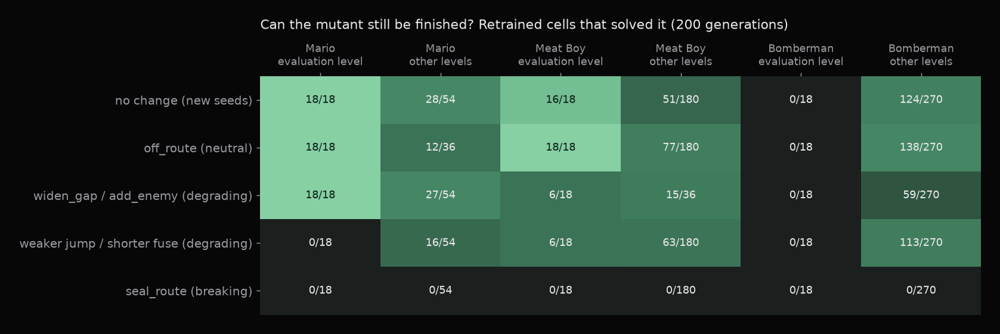</p>

Retrained agents never finish a **sealed** level (0 of 666 runs) and still finish the **neutral** one.
**Degrading** changes make levels harder. Mario's weaker jump acts as **breaking** on 1-1 (0/18).
Bomberman's evaluation level is never solved, so it cannot be judged there.

<p align="center">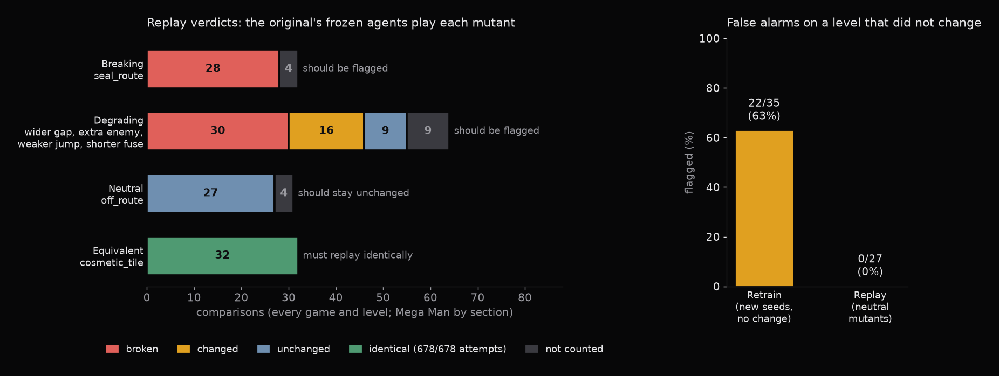</p>

**Replay is the detector**: the original's frozen agents play each mutant, so there is no seed noise.

- It flags **every breaking** mutant it can judge (28 of 28) and **46 of 55 degrading** ones (84%).
- It flags **no neutral** mutant (0 of 27). The cosmetic copy replays **identically** (678 of 678 attempts).
- Retraining with new seeds on a level that did not change raises a signal in **22 of 35** comparisons
  (63%). That is why retraining is not the detector.

A mutant is judged only where the original's agents win, so 4 Bomberman levels (its evaluation level
among them) and the full Mega Man stage are left out. Per-level numbers are in "All result numbers" below.

---

## Pilot user study

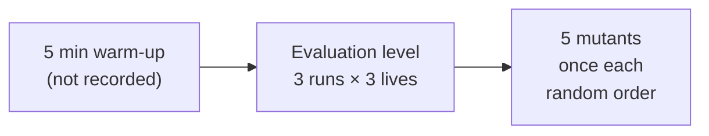

| Participant | p1 | p2 | p3 | p4 | p5 |
|---|---|---|---|---|---|
| Game | Mario | Mega Man | Mario | Mega Man | Mario |
| Runs (baseline + mutants) | 3 + 4 | 3 + 5 | 3 + 5 | 3 + 4 | 3 + 5 |

The participant is not told which mutant is which. Every life is a row in
`runs/user_study/<participant>/<game>/<phase>/run<k>/episodes.csv`, with `mutant` and `mutant_class`.

---

## All the details (for the paper)

Every setting, method and number behind the figures above. Click to open.

<details>
<summary><b>📖 Words used</b></summary>

| Word | Meaning |
|---|---|
| **seed** | Fixes all randomness of one run. Paper seeds: 1234, 2025, 31337. |
| **cell** | One training run: one game, level, persona, GA setting and seed. |
| **generation** | One round in which each of the 10 networks plays the level once. |
| **solved** | The cell won at least once, in any generation. |
| **first-win generation** | The generation of the first win. |
| **win rate** | Share of episodes won in the **10 generations after the first win** (100 episodes). Never solved = 0. |
| **budget** | The most generations a cell may run (200 main, 40 sweeps). A cell stops 10 generations after its first win (`WIN_WINDOW = 10`). |
| **probe** | One cell's folder: `best.npz` (best network), `state.json` (run state), `episodes.csv` (every episode). |
| **report** | One JSON that sums up the cells of one game, persona and setting (`runs/balance/report_*.json`). |
| **tag** | Setting name in file names: `p10g200` = population 10, 200 generations; `p30g200_best` = population 30, `--best`. |
| **mutant / operator / variant** | A one-change copy of a level / the kind of change / what the AST plays (`base`, a mutant, `base-reseeded`, `base-retrained`). |
| **evaluation level** | The one level per game used by the mutation testing and the user study. |
</details>

<details>
<summary><b>🎮 Games, levels, evaluation levels and network sizes</b></summary>

| Game | Levels | Evaluation level | Inputs | Outputs | Weights |
|---|---|---|---|---|---|
| Mario | `Mario1-1` to `Mario1-4` | `Mario1-1` (Super Mario Bros. 1-1) | 14 | 3: left, right, jump | 291 |
| Meat Boy | `0` to `10` (`world1_01_hello_world.txt` to `world1_11_fired.txt`) | `2` (Super Meat Boy 1-3 "The Gap") | 21 | 3 | 403 |
| Bomberman | `0` to `15` (`0`-`11`: `01_open_floor` to `12_chasers`; `12`-`15`: Bomberman II 1-1 to 1-4, `bm2_1_*.txt`) | `12` (Bomberman II 1-1) | 16 | 5: left, right, up, down, bomb | 357 |
| Mega Man | `CutMan-1-Street` … `CutMan-8-Boss` (8 sections) | `CutMan` (the whole stage) | 26 | 6: + fire | 534 |

- Level indices start at 0. Weights = `inputs × 16 + 16 + 16 × outputs + outputs`.
- **Mega Man trains one section at a time.** The whole stage is played by a **relay**: each section's
  agent plays its section, then the next agent takes over (`code/neuro/relay.py`).
- Levels: `code/games/levels/<game>/*.txt`. Settings and level lists: `code/games/game_config.yaml`,
  `meatboy_config.yaml`, `bomberman_config.yaml`, `megaman_config.yaml`, `megaman_levels.yaml`.
  Engines: `code/games/*_core.py`. Mutants: `code/games/levels/mutants/<game>/<id>/`.
</details>

<details>
<summary><b>🧠 The agent: sensors, fitness, GA steps and settings</b></summary>

**Sensors** (`code/neuro/sensors.py`). `rays` (default, every main result): in Mario six raycasts
(forward, forward-up and forward-down at 30° and 60°, back), an enemy corridor, a pit probe, velocity,
"on the ground", "can jump", nearby question blocks = 14 numbers. Meat Boy (21), Bomberman (16) and
Mega Man (26) have their own lists (`SENSOR_LABELS` in `code/neuro/adapters.py`). `grid` (ablation
only): an 11 × 11 tile window, 3 channels (solid, collectible, hazard) + 5 body values = 368 numbers.

**Fitness** (`fitness()` per adapter in `code/neuro/adapters.py`): furthest progress + 5000 for a win +
the persona's extras. Progress = furthest x (Mario); path progress to the exit (Meat Boy); Dijkstra
cost to the exit on a 0 to 1000 scale, a brick costs 6 (Bomberman).

**One generation.** Each of the 10 networks plays one episode. An episode ends at a win, a death,
3600 frames (60 s) or a stall (300 frames without new progress). Then:
1. **Elitism:** the 4 best are copied unchanged.
2. **Tournament:** each parent is the best of 5 picked at random.
3. **Uniform crossover** (p = 0.7).
4. **Gaussian mutation:** each weight with p = 0.15, sigma 0.15.
5. **Annealing:** after the first win, mutation rate and sigma × the anneal factor (0.5).

**Default settings** (`GAConfig`, `code/neuro/evolution.py`): population 10 · elite 4 · tournament 5 ·
crossover 0.7 · mutation rate 0.15 · sigma 0.15 · initial sigma 0.5 · anneal 0.5 · 3600 frames ·
stall 300 · win bonus 5000 · hidden 16 (`tanh`) · no memory · no action feedback.

**`--best`** (`code/neuro/ga_best.yaml`, generated 2026-10-28 08:07; copy in
`runs/ga_best_2026-10-28.yaml`): see the table under "Which GA settings help?". For Mario and Meat Boy
it changes only the anneal factor, which acts after the first win, so first wins equal the default.
</details>

<details>
<summary><b>🧍 The six personas</b></summary>

Same network for all; they differ in **hands** and in **what they are paid for**
(`code/neuro/personas.py`).

| Persona | Sprint | Reacts every | Mistakes | Paid for |
|---|---|---|---|---|
| `novice` | no | 3rd frame | none | the goal |
| `clumsy` | no | 4th frame | 12-frame (0.2 s) mis-press, p = 0.03 per frame | the goal |
| `experienced` | yes | frame | none | the goal |
| `speedrunner` | yes | frame | none | goal + 25 per second left |
| `killer` | no | frame | none | goal + enemies killed |
| `collector` | no | frame | none | goal + coins and power-ups |

Extras are shares of the goal, capped at 1 (killing every enemy pays as much as the goal). A level with
no enemies or coins gives a plain player. Clumsy's mistakes are seeded, so a replay repeats them.
</details>

<details>
<summary><b>🏭 The pipeline stages (Nibi, 2026-10-28)</b></summary>

Started 2026-10-28 4:05 am, resumed 2026-10-29 12:37 pm, ended 2026-10-29 11:06 pm; 3 CPU cores per task; code commit
`79fc29691` (branch `USER-STUDY+SPRITIFY`).

| # | Stage | What it does | Tasks |
|---|---|---|---|
| 1 | `test` | 5-generation smoke test per game | 4 |
| 2 | `mutants` | Every mutant of every level (`eval_mutants --all-levels`, `megaman_mutants`) | 1 |
| 3 | `sweep2d` | Mario, Meat Boy, Bomberman × persona: 40-gen balance sweep, sensor ablation, GA sweep (`run_all.sh sweeps`) | 18 |
| 4 | `sweep_mm` | Mega Man GA sweep, section by section (6 personas × 8 sections) | 48 |
| 5, 7 | `gabest` | Writes `ga_best.yaml` (`gasweep --rebuild`) | 1 + 1 |
| 6 | `confirm_mm` | Confirms Mega Man's winners over all 8 sections | 6 |
| 8 | `full` | **Main training, 200 generations**, every persona and level, default and `--best` (2 × 6 × 31 levels × 3 seeds = 1116 cells; Mega Man's 200-gen agents come from the AST stage) | 372 |
| 9 | `reports` | Rebuilds every report from the probes (`balance --rebuild`) | 1 |
| 10 | `ast_retrain` | Retrains every persona's 3 seeds on every mutant | 1038 |
| 11 | `ast_play` | Playtests, replays, random baselines | 511 |
| 12 | `final` | AST metrics and verdicts → `runs/ast/metrics.json` | 1 |

**GA sweep** values tried (default in brackets): population 30, 100 (10) · elite 1, 6 (4) ·
tournament 2, 8 (5) · crossover 0.0, 0.95 (0.7) · mutation rate 0.005, 0.5 (0.15) · sigma 0.02, 0.5
(0.15) · initial sigma 0.25, 1.0 (0.5) · anneal 0.3, 1.0 (0.5) · hidden 8, 32, 64 (16) · memory 2, 3
(0) · action feedback on (off). Bounds from De Jong, Grefenstette, Miller and Goldberg, Such et al.
A sweep's winners are combined and probed again (`--confirm`). A setting enters `--best` only if it
wins a **strict majority** of the game's sweeps (one per persona).
</details>

<details>
<summary><b>🧪 Mutation testing: placement, retraining, playtests, detection rule</b></summary>

Code: `code/games/eval_mutants.py`, `code/games/megaman_mutants.py`, `code/neuro/ast_eval.py`,
`code/stats/ast_metrics.py`. Rule: `paper-ast/ast_rule.md`.

**Placement.** On the evaluation level the changes are placed by hand (`CHANGES` in
`eval_mutants.py`), for example on Mario 1-1: a wall down column 190 before the flag; the second pit
from 3 to 5 tiles; take-off jump -495 to -420.75 px/s. On every other level the same operators are
placed **by rule** (`place()`): the wall nearest the goal that cuts it off; the gap nearest the start
+2 tiles; one more enemy on the floor tile nearest the centre; the solid tile nearest the start with 4
solid neighbours, hollowed out; the first `.` as a space. Named `<operator>@<level>`; an operator
with no place is skipped and the reason recorded. **Mega Man** uses `s3-seal_route`, `s3-widen_gap`,
`s3-off_route`, `s3-cosmetic_tile` (section 3, Ledges) and `m-jump_velocity_down` (the whole game).
Every mutant is checked in the game before it is written (the change plays; cosmetic parses the same;
off-route is walled in; a flood fill reaches the exit except for `seal_route`). On disk: Mario 23,
Meat Boy 58, Bomberman 96, Mega Man 64.

**Retraining** (`ast_retrain`): each persona's 3 seeds trained from scratch on the mutant, as the
original was (200 generations, the GA setting that won more on that level; Mega Man always `--best`,
section by section). It answers only **"can the mutant still be finished?"**. Two unchanged variants:
`base-reseeded` (3 new seeds: the false-alarm check) and `base-retrained` (Mega Man; its mutants are
compared with it).

**Playtests** (`ast_play`): each agent gets **one attempt with learning off** (the best network of each
seed): 6 personas × 3 seeds = 18 attempts per level. Mega Man: its relay, 20 attempts per scope and
persona (full stage + each section for `base-retrained` and `m-jump_velocity_down`; section 3 alone
for the `s3-` mutants). Files in `runs/ast/<game>/<variant>/`: `agents.csv` (agents trained on it),
`agents_replay.csv` (**the original's frozen agents**), `agents_random.csv` (random player, 2D games).

**Detection rule** (`final`). **Replay is the detector**; frozen deterministic agents leave no seed
noise. A mutant is flagged when any signal holds:

| Signal | Test |
|---|---|
| completion lost | original agents win at least once; on the mutant never |
| win rate | Fisher's exact test, two-sided, p < 0.05 |
| death cluster moved | failed end tiles (Chebyshev radius 3) move > 3 tiles, or appear |
| new top cause | the most common cause of failure changes |

Verdicts: **broken** (completion lost) · **changed** (any other signal) · **unchanged**. Where the
original never wins, nothing is judged. A breaking or degrading mutant is caught when flagged; a
neutral one is right when unchanged; the cosmetic one must match attempt for attempt. Also reported:
win rate against the original's per-seed spread, a strict count (completion or Fisher only), and the
rule's false-alarm rate on `base-reseeded`. The rule was fixed on 2026-10-25 after pilot replays, so
it is **not pre-registered**.

**Metrics** (`ast_metrics.py`): completion, win rate, progress, end location, death cluster, cause
mix, time to finish, play coverage, effort counts (jumps, coins, kills), Mega Man section reached.
`python -m code.stats.ast_paper` writes the paper tables and figures to `paper-ast/`.
</details>

<details>
<summary><b>📊 All result numbers</b></summary>

**Main training, 200 generations**

| Game | GA | Cells solved | Levels solved (any seed) | Levels solved by all 18 | Mean win rate | Median first win | Eval level |
|---|---|---|---|---|---|---|---|
| Mario | default | 44/72 (61%) | 4/4 | 1 | 22.7% | gen 10 | 18/18 |
| Mario | `--best` | 44/72 (61%) | 4/4 | 1 | 27.4% | gen 10 | 18/18 |
| Meat Boy | default | 92/198 (46%) | 11/11 | 1 | 20.6% | gen 34 | 18/18 |
| Meat Boy | `--best` | 92/198 (46%) | 11/11 | 1 | 25.2% | gen 34 | 18/18 |
| Bomberman | default | 103/288 (36%) | 10/16 | 2 | 16.6% | gen 21 | 0/18 |
| Bomberman | `--best` | 133/288 (46%) | 12/16 | 3 | 21.9% | gen 12 | 0/18 |

Mega Man (40-generation sweep baseline, per section): only 5 Rooftop and 7 Corridor solved (18/18).

**GA sweep, 40 generations** (win rate: default → confirmed winners)

| Persona | Mario | Meat Boy | Bomberman | Mega Man |
|---|---|---|---|---|
| novice | 30.4 → 35.3% | 7.8 → 18.4% | 14.7 → 16.0% | 21.4 → 18.7% |
| clumsy | 5.4 → 6.5% | 0.6 → 1.4% | 9.0 → 8.0% | 14.4 → 6.9% |
| experienced | 21.7 → 30.7% | 19.7 → 31.0% | 12.7 → 11.3% | 20.8 → 19.4% |
| speedrunner | 19.9 → 22.8% | 19.7 → 31.0% | 13.2 → 13.2% | 20.6 → 23.0% |
| killer | 23.3 → 7.3% | 12.8 → 15.2% | 10.9 → 13.7% | 22.4 → 22.4% |
| collector | 29.8 → 31.9% | 12.8 → 15.2% | 10.9 → 13.7% | 20.8 → 19.4% |

A sweep's full combination can be worse (Mario killer, Mega Man clumsy), which is why `--best` keeps
only majority winners.

**Sensor ablation, 40 generations**

| Game | rays: cells solved · win rate | grid (368): cells solved · win rate |
|---|---|---|
| Mario (14 inputs) | 37/72 (51%) · 21.7% | 5/72 (7%) · 1.8% |
| Meat Boy (21) | 54/198 (27%) · 12.3% | 9/198 (5%) · 1.4% |
| Bomberman (16) | 62/288 (22%) · 11.9% | 27/288 (9%) · 6.6% |

**Retraining on mutants:** the numbers for Mario, Meat Boy and Bomberman are in the retrain figure
above. Mega Man's retrains (wins of 120 on section 3): `s3-seal_route` 0, `s3-widen_gap` 0, `s3-off_route`
36; `m-jump_velocity_down` is in the "agents retrained on it" column below.

**AST verdicts on the evaluation levels** (wins of 18 attempts; Mega Man: of 120, on section 3, Ledges)

| Variant | Mario 1-1 | Meat Boy 2 | Mega Man section 3 |
|---|---|---|---|
| original (`base`; Mega Man `base-retrained`) | 15/18 | 15/18 | 36/120 |
| `seal_route`, replay | 0/18 **broken** | 0/18 **broken** | 0/120 **broken** |
| `widen_gap`, replay | 11/18 **changed** | 2/18 **changed** | 1/120 **changed** |
| `jump_velocity_down`, replay | 0/18 **broken** | 6/18 **changed** | see below |
| `off_route`, replay | 15/18 unchanged | 15/18 unchanged | 36/120 unchanged |
| `cosmetic_tile`, replay | 18/18 identical | 18/18 identical | 120/120 identical |

Bomberman's evaluation level is left out: its original is never won (0/18), so no mutant there can be
judged. Its cosmetic copy still replays identically (18/18).

**Mega Man `m-jump_velocity_down`** (jump ×0.85 on the whole game), by section (wins of 120)

| Section | original | agents retrained on it | replay | replay verdict |
|---|---|---|---|---|
| 1 Street | 49 | 37 | 1 | changed |
| 2 Climb | 97 | 0 | 0 | **broken** |
| 3 Ledges | 36 | 30 | 9 | changed |
| 4 Shaft | 55 | 0 | 0 | **broken** |
| 5 Rooftop | 120 | 119 | 120 | unchanged |
| 6 Descent | 105 | 99 | 78 | changed |
| 7 Corridor | 120 | 120 | 120 | unchanged |
| 8 Boss | 80 | 76 | 83 | unchanged |

**False alarms** (`base-reseeded` against the original, 35 counted comparisons): completion lost 2,
win rate changed 4, death cluster moved 17, top cause changed 9; any signal 22 (63%); completion or
Fisher only ("strict") 6 (17%); win rate outside the original's seed spread 4 of 27.
</details>

<details>
<summary><b>⚠️ Known limits and caveats</b></summary>

1. **Bomberman's evaluation level (12, Bomberman II 1-1) was never solved**, in training and every
   retrain, so its mutants cannot be judged. (An older version used level 8, "09 Two Balloms";
   `paper-ast/ast_rule.md` still says "Bomberman 09". The code and this run use 12.)
2. **Mario `jump_velocity_down` acts as breaking for agents on 1-1** (0/18): with jump ×0.85 the
   4-tall pipe at column 57 cannot be cleared from the ground; only a Goomba bounce gets past it.
3. **"Solved" is a low bar for clumsy:** 37 solved cells show a 0% win rate, all clumsy.
4. **Meat Boy has 4 distinct agent sets, not 6** (experienced = speedrunner, killer = collector).
   Why the time bonus makes no difference there is not checked.
5. **`--best` for Mario and Meat Boy only changes annealing**, so first wins equal the default.
6. **The detection rule is not pre-registered** (fixed 2026-10-25, after pilot replays).
7. **Retraining is not a detector:** in an earlier run the rule fired in 6 of 10 `base-reseeded`
   comparisons. `final` measures this again.
8. **Mega Man** sections trained from new seeds sometimes fail outright (Street, Climb in earlier runs).
9. **Replay-wall videos** (`runs/videos/`) show older agents.
10. **Pilot study:** p1 and p4 have 4 of 5 mutation runs; Test1 and test111 (Meat Boy) are test sessions.
11. **The win-rate window is short:** 10 generations, 100 episodes.
</details>

<details>
<summary><b>📁 Where the data is, and the file formats</b></summary>

| Folder | What is in it |
|---|---|
| `runs/balance/` | Every report JSON: `report_*` (training), `gasweep_*`, `ablation_*` |
| `runs/probes/<game>/<persona>/<tag>/<level>_<seed>/` | Main training, one folder per cell |
| `runs/gasweep/…`, `runs/ablation/…` | GA sweep and sensor-ablation probes, same layout |
| `runs/ast/<game>/<variant>/` | AST reports, `agents*.csv` playtests, `probes/` (retrained agents) |
| `runs/ast/metrics.json` | AST metrics and verdicts (after `final`) |
| `runs/user_study/<participant>/<game>/<phase>/run<k>/` | Pilot study: `episodes.csv`, `inputs.csv` |
| `runs/manual/<game>/<player>/` | Free manual play with `--record` |
| `runs/logs/` | Slurm logs of every Nibi stage |
| `runs/videos/<game>/<persona>.webm` | Replay-wall videos |
| `code/neuro/ga_best.yaml` | `--best` per game, with every sweep's numbers |
| `code/games/levels/mutants/<game>/<id>/` | Each mutant: `mutant.json` (change, class, why) + level file |
| `paper-ast/` | AST paper draft, rule, tables, figures |

**`best.npz`**: the best network's weights. **`state.json`**: GA settings (`config`), persona, best
fitness, and every generation's history (wins, average fitness, best progress, each episode).

**Report JSON**: `game`, `persona`, `tag`, `pop_size`, `gens_budget`, `seeds`, `ga_config`,
`train_time_s`, `levels` (per level: `solved_by`, `seeds`, `first_win_mean` / `_ci`, `win_rate_mean` /
`_ci`), `cells` (per level and seed: `first_win_gen` (null = never), `win_rate`, `gens_run`, `best`,
`causes`, `completion_rate`, `deaths_per_win`, `progress_at_death`, `stuck_frac`, `death_hist`,
`death_cluster_entropy`, `coin_collection_rate`, `novice_expert_gap`, `improvement_rate`, `trend`).

**Agent `episodes.csv`** (probes): `persona`, `game`, `world`, `cause_of_death` (`success` = win),
`jump_count`, `coins_collected`, `avg_vx`, `progress_ratio`, `route`, `enemies_killed`,
`bricks_destroyed`, `elapsed_time`.

**Human and playtest files** (`code/stats/episode_log.py`): 12 shared columns `persona` (participant
ID for people), `game`, `level`, `source`, `session`, `gen`, `agent`, `status` (`WON` = win), `cause`,
`frames`, `time_s`, `progress`, then per-game columns (Mario: `jumps`, `coins`, `kills`, `avg_speed`,
`end_x`, `end_y`, `tile`, `bricks`, `run_result`, `lives_used`, `life`, `recorded_at`, `route`); the
study's mutation rows add `mutant` and `mutant_class`.
</details>

<details>
<summary><b>⌨️ Commands to reproduce</b></summary>

```bash
# Main training (one game, persona, level; 200 generations; paper seeds)
python -m code.neuro.balance --game mario --persona novice --levels Mario1-1 --gens 200 --seeds 1234 2025 31337
python -m code.neuro.balance --game mario --persona novice --levels Mario1-1 --gens 200 --seeds 1234 2025 31337 --best

# GA sweep and sensor ablation (40 generations)
GAMES=mario PERSONAS=novice bash run_all.sh sweeps
python -m code.neuro.gasweep --game megaman --persona novice --levels CutMan-1-Street --gens 40 --seeds 1234 2025 31337
python -m code.neuro.gasweep --rebuild                       # rewrite code/neuro/ga_best.yaml

# Mutants
python -m code.games.eval_mutants --all-levels               # Mario, Meat Boy, Bomberman
python -m code.games.megaman_mutants                         # Mega Man
python -m code.games.eval_mutants --list

# AST: retrain, playtest, replay, random baseline, metrics, paper tables
python -m code.neuro.ast_eval retrain --game mario --mutant seal_route --persona novice
python -m code.neuro.ast_eval retrain --game megaman --mutant base-retrained --persona novice --level CutMan-1-Street
python -m code.neuro.ast_eval play --game mario --variant base
python -m code.neuro.ast_eval play --game mario --variant seal_route --replay
python -m code.neuro.ast_eval play --game mario --variant base --random
python -m code.stats.ast_metrics                             # runs/ast/metrics.json
python -m code.stats.ast_paper                               # paper-ast/

# Reports, figures, website
python -m code.neuro.balance --rebuild
python -m code.neuro.figures                                 # docs/img/fig_*.png
python -m code.neuro.command_center --open

# Watch an agent; play a level or a mutant yourself; tests
python -m code.neuro.trainer --game mario --replay runs/probes/mario/novice/p10g200/Mario1-1_1234/best.npz
PEAK_MUTANT=code/games/levels/mutants/mario/seal_route python -m code.games.tools.manual_play --game mario --level Mario1-1
python -m pytest code/tests -q
```

The menu (`python menu.py`) runs all of these; option `u` runs the user study.
</details>

---

## Authors

**Al (AI-Scripting)** &nbsp;·&nbsp; **Kevin Chu**

Ontario Tech University, Master's program. Engines, evolution and dashboards built from scratch in
Python, Pygame and numpy. Statistics-dashboard metrics designed with Amr Abdalla's statistics-observer
work. The earlier deep-RL version (stable-baselines3 PPO) is on the `archive/drl-sb3-final` branch.
